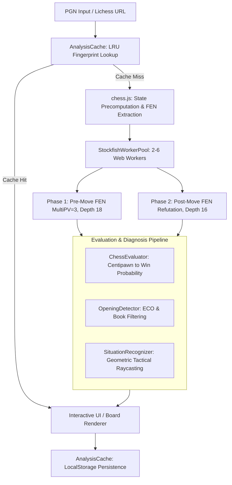

# WhyBlunder

WhyBlunder is an in-browser, zero-backend chess game analyzer. It runs a parallelized pool of WebAssembly-compiled Stockfish engine workers directly on the client to classify move quality, detect tactical patterns, and generate human-readable explanations without server infrastructure.

Traditional chess analysis platforms route game evaluations to centralized server queues, introducing network latency, rate limits, infrastructure operating costs, and subscription walls. WhyBlunder offloads the entire computational pipeline (UCI engine evaluation, win-probability modeling, tactical pattern recognition, and variation tree parsing) to client Web Workers.


---

## Architecture & Data Flow

WhyBlunder executes an asynchronous, client-side analysis pipeline:



---

## Core Mechanisms

### 1. Multi-Worker Parallel Engine Pool (`js/browser-analyzer.js`)

WhyBlunder bypasses single-threaded WebAssembly bottlenecks by running an asynchronous worker pool configured to the host machine's hardware concurrency:

```javascript
// Worker pool sizing heuristic
const concurrency = navigator.hardwareConcurrency || 4;
const poolSize = Math.max(2, Math.min(concurrency >= 4 ? concurrency - 1 : concurrency, 6));
const pool = new StockfishWorkerPool(poolSize);
```

- **Hash & MultiPV Allocation**: Each worker initializes Stockfish with a 32 MB hash table (`setoption name Hash value 32`) and searches 3 principal variations (`setoption name MultiPV value 3`).
- **Two-Phase Ply Dispatch**:
  1. **Phase 1 (Pre-move)**: Dispatches the pre-move FEN at `depth 18` across idle workers. If the played move matches MultiPV line 1, evaluation is complete.
  2. **Phase 2 (Post-move refutation)**: If the played move was suboptimal and missing from MultiPV lines 2–3, WhyBlunder triggers a targeted search of the post-move FEN at `depth 16` to calculate the opponent's precise refutation line.
- **Safety Timeout**: Workers enforce an explicit 20-second execution cap per position to prevent hung WASM processes on complex endgames.

### 2. Win Probability & Move Classification (`js/chess-evaluator.js`)

Engine centipawn scores ($cp$) are converted to winning probabilities ($WP \in [0.0, 1.0]$) using a standard logistic model centered at zero:

$$WP = \frac{1}{1 + 10^{-cp / 400}}$$

Mate scores are mapped to a bounded centipawn scale: $cp = \text{sign}(m) \times (10000 - 10 \cdot |m|)$ for mate in $m$ moves.

| Classification | Condition / Win Probability Drop ($\Delta WP$) | Fallback Safeguard |
| :--- | :--- | :--- |
| **Brilliant** | Played move is best $\land$ True Sacrifice $\land\ WP_{after} \ge 0.60 \land WP_{secondBest} \le 0.90 \land (WP_{after} - WP_{secondBest}) \ge 0.05$ | N/A |
| **Great / Best** | Played move is best $\land$ ($\text{isOnlyMove} \lor \Delta WP \le 0.01$) | N/A |
| **Book** | Move sequence matches ECO database ($\le \text{ply } 16$) | N/A |
| **Inaccuracy** | $0.04 \le \Delta WP < 0.10$ | Downgraded from mistake in winning conversions ($WP > 0.90$) |
| **Mistake** | $0.10 \le \Delta WP < 0.22$ | N/A |
| **Blunder** | $\Delta WP \ge 0.22 \lor (\text{Missed Win: } WP_{before} \ge 0.85 \land WP_{after} < 0.55)$ | Prevents false blunders when simplifying at $WP \ge 0.95$ with $\Delta WP < 0.15$ |

### 3. Tactical Situation Recognizer (`js/situation-recognizer.js`)

Rather than showing raw engine output, WhyBlunder applies 64-square raycasting and attack graphs to extract concrete chess concepts:

- **Tactical Forks**: Scans piece attacks to detect simultaneous threats against higher-value or undefended targets; filters out capturable attackers via `isPieceSafe()`.
- **Pins & Skewers**: Traces sliding attack rays (Queen, Rook, Bishop) through intermediate targets to King or high-value pieces.
- **Hanging Pieces**: Identifies unprotected pieces moved to attacked squares or abandoned defenders.
- **Positional Patterns**: Detects center pawn duos (`d4`/`e4`), open file rook control, 7th-rank infiltration, true outposts, and castling forfeits.

```javascript
// Example structured output schema from SituationRecognizer
{
  flaw: "leaves the bishop hanging on e6, which allows dxe6 capturing the exposed piece",
  missedChance: "missed winning the enemy Queen with Rxd4",
  betterLine: "Bc4 was much better because it maintains the active diagonal",
  tags: ["Hanging Piece", "Tactical Fork", "Center Control"]
}
```

### 4. Client-Side LRU Cache (`js/analysis-cache.js`)

Analyses persist in `localStorage` under `whyblunder_analysis_cache_v1`:

- **Fingerprint Normalization**: Strips headers, PGN comments (`{}`), variations (`()`), NAGs (`$N`), and clock stamps before generating a base-36 hash key.
- **LRU Eviction**: Caps storage at 5 full game analyses. When quota exceptions occur, the cache automatically truncates the oldest 50% of entries.
- **Lichess URL / ID Resolving**: Directly retrieves cached evaluations for game IDs (e.g., `https://lichess.org/Qa7FJNk2`).

### 5. Self Review Before the Engine (`js/self-review.js`)

Most coaches agree that an engine-only review teaches little. You should first go through the game with your own thinking, and only then compare it with the engine. After analysis, WhyBlunder offers a self review before it shows any verdict:

- **By phase**: The game is split into opening, middlegame and endgame. Each phase asks for your plan, then how you stood when the phase ended.
- **Critical moments, unlabeled**: The engine picks up to 8 positions for your side (at most 3 per phase). These include your errors, only-moves and chances to punish your opponent, so the list itself gives nothing away. At each one you rate the position and your move, can drag a better move on the board, and note what you were thinking. The eval bar and classifications stay hidden. A spoiler-free move list lets you step back and forth through the game. A moment you leave without rating gets a **Need review** flag, and you can't move on to the next phase until it is answered.
- **Compare**: Your answers are lined up against the engine: mistakes you spotted, positions you judged correctly (and whether you were over- or under-optimistic), and better moves you found. You get up to three takeaways. Your notes then appear under the engine's explanation of each move.

Reviews are saved in `localStorage` under `whyblunder_self_review_v1` (the 30 most recent games). A checkbox lets you skip straight to the engine analysis.

### 6. Annotated PGN Export (`js/pgn-export.js`)

After the review, **Export annotated PGN** in the Game Review panel (or the download chip in the Moves header) saves the game as a standard PGN that Lichess studies, ChessBase or SCID can import. The copy button puts the same text on the clipboard. The export contains:

- **Evaluations**: a `[%eval]` tag after every move (White's point of view, `#n` for mates).
- **Classifications**: NAGs (`!!`, `!`, `?!`, `?`, `??`) and a comment with the verdict, the best move and the "why" text, plus the threat the move ignored.
- **Engine lines**: for each inaccuracy, mistake, miss and blunder, the alternatives that beat it, and the punishment line when the opponent missed it. A checkbox adds the engine's alternatives for every move.
- **Your work**: the lines you tried on the board ("Your line") and your self-review answers.

The accuracy and the opening go in the opening comment. The export is pure and deterministic, and it runs in Node too (`PgnExport.build(moves, options)`).

### 7. AI Game Article in the Style of GothamChess (optional, `js/game-commentary.js`)

Once the analysis is done, an LLM can write an article about the game in the style of GothamChess (Levy Rozman), like one of his recap videos turned into a blog post. On desktop the right column gets two tabs: **Article** gives the whole column to the article, and **Analysis** holds the engine's move explanation and the move list as before. On mobile the article sits in the bottom sheet, with an **Engine / AI** toggle at its top.

The article has a title, a short intro (the players, the opening and its main idea), sections that follow the story of the game, named after what happens in them, and a **Lessons** section with 2–4 takeaways. It spends its words on the moments that decided the game and covers quiet stretches in a sentence or two. One request covers the whole game: the players, the opening and the result, the moves, the final position, and the engine notes of the key moments only. Those are the inaccuracies, mistakes, misses, blunders, great and brilliant moves, and the moves that punish a mistake or miss its punishment, each with the position before it, its comment, the better lines and the punishment line. The length asked for grows with the number of key moments (300 to 1000 words), and a short game stays short.

The engine's annotations are the model's private notes, not something to read out. It explains what each key move is trying to do, what goes wrong and why the better move is better, and plays the lines out. It never quotes evaluation numbers or says "Stockfish says", and when the overall picture matters it says it in plain words ("White is just winning"). It must not invent tactics the analysis doesn't support. It writes every move with its number ("14... Qd7"), so the moves can be linked.

The article is requested as soon as the analysis finishes (if the Article tab is the one selected) and streams in. **Stop** stops it, **Regenerate** writes a new one, and after an error **Try again** retries it. Nothing is sent while the Analysis tab is selected. Articles are saved in `localStorage` (`whyblunder_commentary_v6`, the 8 most recent games).

Markdown in the answer is rendered: bold, italics, headings, bullet and numbered lists, quotes, inline code and rules. Move numbers like "1. e4 e5" at the start of a line stay chess, not a list. Any HTML the model writes is shown as text, and links keep only their text.

Moves in the article become clickable once it is written. A move of the game ("5... Bxd1??", "White's Bc4") goes to that move. Any other line ("5... dxe5 6. Qxg4") opens on the board as a **Commentary Line** you can step through and leave with Return, like the engine's lines; the game first goes to the move the line branches off from. Each move is checked with chess.js against the position it belongs to: a move of the game with the same number, the end of the line just mentioned, or for a move written without a number, the positions around the last game move the article named. Text that doesn't check out stays plain text, as do squares like "the pawn on e5". The article follows the board: as you step through the game, the move on the board is highlighted in the text, and the passage about it is marked and scrolled into view.

There is still no backend: the browser calls the LLM directly. Set it up under **Settings → AI commentary** (the sidebar on desktop, the Options sheet on mobile) before you load a game, or open the Article tab and fill in the form it shows. You need:

- **Base URL** of any OpenAI-compatible API, default `https://api.openai.com/v1` (`/chat/completions` is appended),
- **Model**, e.g. `gpt-4o-mini`,
- **API key** (optional for a local server such as Ollama or LM Studio).

They are kept in `localStorage` (`whyblunder_llm_settings_v1`) and the key is only sent to that URL. Tick **Show AI commentary instead of the engine's explanation** to have every analysis open on the Article tab and write its article as soon as it finishes. Change or forget them later under **Settings → AI commentary**. The panel only asks for them the first time. The endpoint has to accept requests from a browser (CORS). OpenAI and OpenRouter do; for Ollama, start it with `OLLAMA_ORIGINS=*`.

---

## Architectural Trade-offs

| Design Choice | Approach Chosen | Alternative Approach | Technical Trade-off |
| :--- | :--- | :--- | :--- |
| **Engine Execution** | In-browser WebAssembly Web Workers | Backend server cluster (e.g., Celery + Stockfish binary) | Eliminates all server infrastructure costs and scaling bottlenecks; increases client CPU and battery consumption during analysis runs. |
| **Ply Scheduling** | Concurrent out-of-order dispatch across worker pool | Chronological sequential search | Accelerates full-game analysis (10–15s for 60 plies on 8 cores); cannot share transposition tables (TT) between consecutive plies across workers. |
| **Memory Allocation** | Static 32 MB hash table per worker | Shared single large transposition table | Avoids cross-origin isolation and `SharedArrayBuffer` deployment requirements; limits deep endgame table hit rates on constrained devices. |

---

## Local Development & Testing

WhyBlunder requires no build steps or bundlers. All modules use UMD wrappers compatible with native browser scripts and Node.js.

### 1. Run Locally

Serve the repository root using any static file server:

```bash
# Python 3
python3 -m http.server 3030

# Node.js
npx serve .
```

Open `http://localhost:3030` in a browser supporting WebAssembly and Web Workers.

### 2. Run Test Suite

Verify evaluation formulas, opening recognition, material differentials, and tactical detectors in Node.js:

```bash
node test_browser_modules.js
```

---

## Constraints & Limitations

- **Transposition Table Isolation**: Because Web Workers operate in isolated memory spaces without shared memory buffers, duplicate positions across variations are evaluated independently by each worker.
- **Hardware Concurrency Ceiling**: Systems with fewer than 4 threads fall back to 2 workers to maintain UI responsiveness, extending analysis times on budget mobile devices.
- **WASM Fallback**: Environments lacking WebAssembly validate against `js/stockfish.js` (asm.js), resulting in a ~3x reduction in search throughput.
- **Depth Constraints**: Default analysis is fixed at depth 18 for pre-move evaluations and depth 16 for refutations to balance tactical depth against client runtimes.

